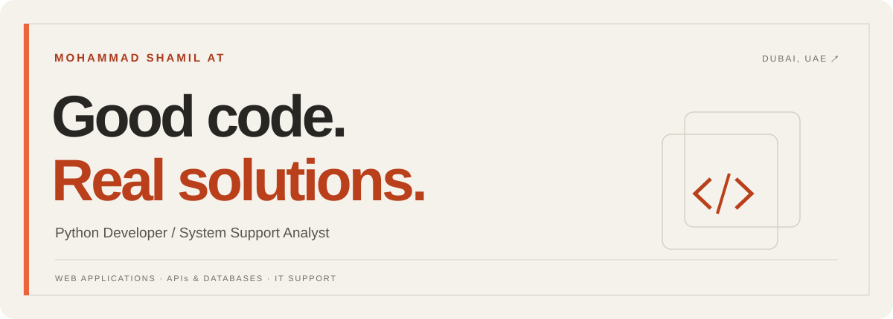

  

  
  
  

<strong>Thoughtful web experiences. Dependable business systems.</strong> 
I build responsive applications with Python and help teams resolve the technical issues behind everyday operations.

---

### 01 / HELLO, I’M SHAMIL

I’m **Mohammad Shamil AT**, a **Python developer and system support analyst** based in **Dubai, UAE**. My experience combines full stack web development with hands-on support for hardware, software, user accounts, and business applications.

I enjoy connecting a clear user interface to a reliable backend—and investigating the details when something goes wrong.

| Build the experience | Connect the pieces | Keep it running |
| :--- | :--- | :--- |
| Responsive websites and web applications | REST APIs and relational databases | Technical troubleshooting and user support |
| HTML, CSS, JavaScript, Bootstrap | Python, Django / Flask, SQLite | System installation, access control, documentation |

### 02 / SELECTED WORK

<table>
<tr><td valign="top">
01 · E-COMMERCE
<h3><a href="https://github.com/shamil790/marte-commerce-website">BigMart ↗</a></h3>

A responsive supermarket storefront with product categories, search, and filtering. Developed with a Python / SQLite backend and HTML, CSS, and Bootstrap, alongside Shopify-based commerce.

PYTHON · SQLITE · HTML · CSS · BOOTSTRAP · SHOPIFY

<a href="https://github.com/shamil790/marte-commerce-website">Explore the repository →</a>
</td></tr>
<tr><td valign="top">
02 · HEALTHCARE
<h3><a href="https://github.com/shamil790/medicare-hospital-management">Hospital Management System ↗</a></h3>

A web application for appointment booking, patient registration, and profile management. Includes role-based access for administrators, doctors, receptionists, and patients, with backend APIs and a relational database.

AUTHENTICATION · ROLE-BASED ACCESS · APIs · PATIENT MANAGEMENT

<a href="https://github.com/shamil790/medicare-hospital-management">Explore the repository →</a>
</td></tr>
<tr><td valign="top">
03 · CORPORATE WEBSITE
<h3><a href="https://securehubsvt.ae/">SecureHub SVT ↗</a></h3>

A responsive security services website with service pages, contact and enquiry forms, WhatsApp messaging, and search engine optimization. Built with a focus on mobile usability and cross-browser compatibility.

RESPONSIVE WEB DESIGN · WHATSAPP · ENQUIRY FORMS · SEO

<a href="https://securehubsvt.ae/">Visit the website →</a>
</td></tr>
</table>

### 03 / THE TOOLKIT

  
  
  
  
  
  
  
  

| Area | Technologies & skills |
| :--- | :--- |
| **Web development** | Python, JavaScript, Django / Flask, HTML, CSS, XML, Bootstrap |
| **APIs & data** | REST APIs, SQLite, MySQL / PostgreSQL |
| **Commerce & collaboration** | Shopify, Git, GitHub |
| **System support** | Hardware and software troubleshooting, system installation, accounting software support, user access management |
| **Working with teams** | Technical documentation, incident records, client relationships, collaboration |

### 04 / EXPERIENCE

**System Support Analyst · Famous Trading**  
*May 2023 – June 2026*

- Diagnosed hardware, software, and network issues affecting daily business operations.
- Installed and maintained accounting software, supported users, and managed accounts and permissions.
- Monitored system performance and maintained incident logs, asset records, and support documentation.

**Python Full Stack Developer · Luminar Technolab**  
*September 2022 – April 2023*

- Developed web applications using Django / Flask and responsive frontend technologies.
- Designed REST APIs and worked with MySQL / PostgreSQL databases and optimized queries.
- Participated in debugging, testing, and application performance improvements.

<strong>Education & languages</strong>

**Bachelor of Computer Science & Technology · 2022**  
Malabar College of Engineering & Technology, Thrissur

**Languages:** English · Malayalam · Tamil

---

<h2 align="center">Have something in mind?</h2>

A web application. An IT support opportunity. A technical challenge.

<a href="mailto:shamshazz9745@gmail.com"><strong>shamshazz9745@gmail.com</strong></a>

<a href="https://www.linkedin.com/in/mohammed-shamil-at-">LinkedIn ↗</a> &nbsp;·&nbsp; <a href="https://github.com/shamil790?tab=repositories">Projects ↗</a> &nbsp;·&nbsp; Dubai, UAE

